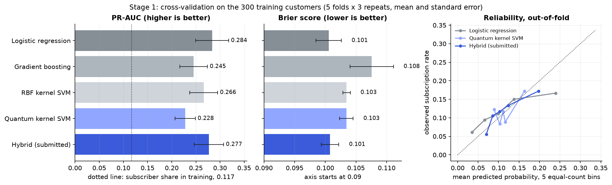
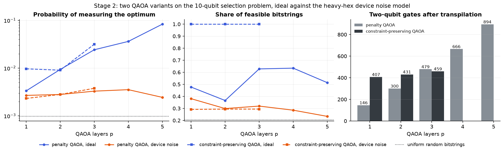
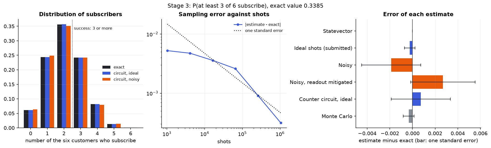
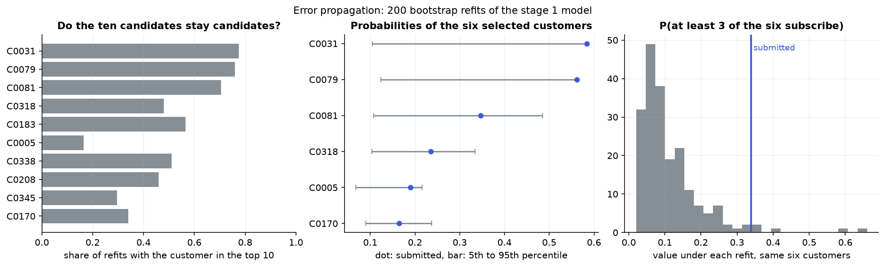

# Quantum campaign targeting: who to call, and how likely the campaign is to work

My entry for The Atomiq Hackathon (Qiskit Fall Fest 2026 at IEM). A bank wants to run a term-deposit campaign. I predict who is likely to subscribe, use a quantum optimiser to pick six customers to contact, and use a quantum circuit to estimate the chance that at least three of them subscribe.

**Final answer**

| | |
|---|---|
| Six customers to contact | **C0031, C0079, C0081, C0318, C0005, C0170** |
| Probability that at least 3 of them subscribe | **0.3382** (quantum estimate, 1,048,576 shots). Exact value from the same probabilities: 0.3385 |
| Expected net value of the selection | 24.533, equal to the brute-force optimum (gap 0.0) |
| Budget and capacity used | 15 of 25, and 12 of 22 |

Everything is rebuilt by one command, `python run_pipeline.py`, in two to four minutes on a laptop. Two runs give byte-identical result files, and a test checks that.

Four things I found that I think matter more than the headline numbers:

1. **The budget and capacity limits never bind for my ten candidates.** The most expensive possible group of six costs 20 (limit 25) and the most capacity-hungry needs 17 (limit 22), so all 210 groups of six are feasible. I still built and verified the full constraint handling, and I added a stress test with tightened limits to show it works when the limits do bind.
2. **QAOA finds the optimum, but so would random guessing at this size.** With 8192 shots, uniformly random bitstrings contain the optimum with probability 99.97%. What QAOA adds is measured per shot: it raises the chance of the optimal bitstring from 0.0010 to 0.0243 (25 times). I make no claim of quantum advantage anywhere in this project.
3. **On the device noise model I assume, the QAOA signal is almost gone.** The p = 3 circuit needs 479 two-qubit gates on heavy-hex hardware, and its output is close to uniform noise (optimum probability 0.0033, against 0.0010 for random bitstrings).
4. **Stage 1 uncertainty dominates everything else.** The shot noise of the Stage 3 estimate is about 0.0005. The spread caused by refitting the Stage 1 model on resampled training data is about 0.09, roughly 191 times larger. The same six customers get a lower probability in 98% of those refits, so the submitted number is very sensitive to the training sample.

## Contents

1. [Pipeline architecture](#1-pipeline-architecture)
2. [Stage 1: subscription prediction](#2-stage-1-subscription-prediction)
3. [Mathematical formulation of Stage 2](#3-mathematical-formulation-of-stage-2)
4. [Stage 2 results](#4-stage-2-results)
5. [Stage 3: campaign outcome simulation](#5-stage-3-campaign-outcome-simulation)
6. [Circuit design and transpilation](#6-circuit-design-and-transpilation)
7. [Classical vs quantum rigor](#7-classical-vs-quantum-rigor)
8. [Error and noise analysis](#8-error-and-noise-analysis)
9. [Setup and execution](#9-setup-and-execution)
10. [Business impact](#10-business-impact)
11. [Limitations](#11-limitations)
12. [References](#12-references)

## 1. Pipeline architecture

```
organisers' workbook (data/bank_campaign_participant_release.xlsx)
        |
        v
STAGE 1  300 labelled customers -> cross-validation -> final fit -> 100 test probabilities
         quantum:   6-qubit ZZ feature map, fidelity kernel            (Qiskit)
         classical: preprocessing, SVM on the kernel, Platt scaling, logistic regression
         output:    stage1_predictions.csv  (rank, top-10 flag)
        |
        |  top 10 customers, same probabilities, same ids
        v
STAGE 2  choose exactly 6 of 10: maximise sum(p * deposit_value - cost), budget and capacity limits
         classical: brute force over all 1,024 bitstrings (the reference)
         quantum:   QUBO -> Ising -> QAOA, 10 qubits, sampled on Aer   (Qiskit, Qiskit Aer)
         output:    stage2_selection.csv / .json
        |
        |  6 selected customers, same probabilities, same ids
        v
STAGE 3  P(at least 3 of 6 subscribe)
         quantum:   one RY qubit per customer, measured                (Qiskit, Qiskit Aer)
         classical: exact Poisson-binomial value, Monte Carlo
         output:    stage3_simulation.csv / .json
        |
        v
ERROR PROPAGATION  200 bootstrap refits of Stage 1, pushed through Stages 2 and 3
```

The stages are linked through `customer_id` and through one set of probabilities. Stage 1 rounds its probabilities once to 12 decimals, and those exact values are what the CSV holds and what Stages 2 and 3 compute with. A test (`tests/test_result_files.py`) reads the three files back and checks that the ids and probabilities are identical in all of them, and that the Stage 2 objective and the Stage 3 exact value can be recomputed from the Stage 1 file and the workbook alone.

What is quantum and what is classical:

| Step | Quantum | Classical |
|---|---|---|
| Stage 1 features | | row-wise feature engineering, scaling, one-hot encoding, PLS or PCA to 6 numbers |
| Stage 1 kernel | 6-qubit ZZ feature map, kernel entry = squared overlap of two feature-map states | |
| Stage 1 classifier | | SVM on the kernel matrix, Platt scaling, logistic regression, the 50/50 average |
| Stage 2 formulation | | QUBO, penalty weights, Ising map, brute-force reference |
| Stage 2 optimiser | QAOA circuits (two variants), sampled bitstrings | COBYLA outer loop, decoding and feasibility check |
| Stage 3 | six RY rotations, measurement, counter circuit | exact formula, Monte Carlo, readout-error inversion |

Repository layout:

```
run_pipeline.py            one command that rebuilds every result
build_report.py            fills this README from the result files
src/campaign/
  config.py                every seed, grid, shot count and noise number
  data.py                  loads and validates the workbook
  features.py  models.py   feature engineering, classifiers, quantum kernel
  stage1.py                cross-validation, final fit, ranking
  qubo.py                  brute force, two QUBO encodings, Ising map, penalty rule
  qaoa.py                  QAOA circuits, exact emulators for training, Dicke state, CVaR
  stage2.py                the Stage 2 study and the selection
  stage3.py                Stage 3 circuits, exact values, readout mitigation
  hardware.py              heavy-hex coupling map, noise model, transpilation statistics
  propagation.py           bootstrap error propagation
  outputs.py  figures.py   result files and figures
tests/                     pytest suite
notebooks/walkthrough.ipynb   executed notebook that walks through the three stages
stage1_predictions.csv  stage2_selection.csv/.json  stage3_simulation.csv/.json   required result files
results/                   cross-validation table, QAOA runs and counts, transpilation, seeds, environment, figures
presentation.pdf           the deck
```

## 2. Stage 1: subscription prediction

**Data.** 300 labelled customers, 35 of them subscribers (11.7%), and 100 unlabelled test customers. Fifteen features (age, job, marital status, education, default, balance, housing loan, personal loan, contact type, day, month, number of contacts, days since last contact, previous contacts, previous outcome).

**Leakage control.** Feature engineering is row-wise only (signed log of balance, logs of the count columns, a "contacted before" flag from `pdays = -1`). Everything that learns from data (scaler, one-hot levels, PCA or PLS, the SVM, Platt scaling) is fitted inside scikit-learn estimators on training rows only, and inside cross-validation on the training part of each fold only. The test sheet has no labels. The submitted model is chosen and fitted before it sees a test row, and predicts the test rows once. Later analyses (the comparison models, the bootstrap refits) also predict the test features, without labels and without any feedback into the choice of model or settings. Tests check that the fitted scaler holds exactly the training statistics, that a prediction does not change when the other test rows are shuffled or corrupted, and that refitting on the 300 training rows reproduces the submitted file.

**Models.**

- *Classical baseline:* L2 logistic regression without class weighting (calibration is measured in cross-validation). 5 values of C.
- *Classical reference:* gradient boosting with fixed conservative settings.
- *Quantum:* a fidelity quantum kernel classifier. The features are reduced to 6 numbers, standardised, multiplied by a bandwidth and used as rotation angles of Qiskit's `zz_feature_map` on 6 qubits with linear entanglement. The kernel entry for two customers is the squared overlap of their two circuit states. The kernel matrix goes into an SVM, and Platt scaling on out-of-fold SVM scores turns the scores into probabilities (the whole chain, including the reduction, is refitted inside every calibration fold, so a score never comes from a model that saw that row or its label). Grid: reduction by PCA or PLS, 1 or 2 feature-map repetitions, three bandwidths, three values of C (36 settings).
- *Classical control:* the same pipeline with a Gaussian (RBF) kernel in place of the circuit, same inputs, same grid (18 settings). It isolates what the quantum feature map adds.
- *Hybrid (submitted):* the fixed 50/50 average of the tuned logistic regression and the tuned quantum kernel classifier. The weight is not tuned.

**How the submitted model is chosen.** Within each family the setting with the highest mean cross-validated PR-AUC wins (ties within 0.005 go to the lower Brier score). The submitted model is the hybrid, by design: the challenge asks for a quantum or hybrid classifier and treats the classical model as the baseline. The score did not make this choice. On the tuning metric (PR-AUC) logistic regression is slightly ahead, and the two models are level within the fold scatter, as the tables below show.

**Validation.** Repeated stratified 5-fold cross-validation, 3 repeats, seed 42, same folds for every model, training rows only. Mean over the 15 folds, plus or minus the standard deviation of the fold scores divided by the square root of 15:

| Model | Setting | ROC-AUC | PR-AUC | P@10 | R@10 | Brier | Log loss | ECE | Cal. slope |
|---|---|---|---|---|---|---|---|---|---|
| Logistic regression (classical baseline) | C=0.3 | 0.620 ± 0.024 | 0.284 ± 0.034 | 0.187 | 0.267 | 0.1005 ± 0.0021 | 0.3544 ± 0.0078 | 0.030 | 0.59 |
| Gradient boosting (classical reference) | fixed | 0.585 ± 0.024 | 0.245 ± 0.029 | 0.187 | 0.267 | 0.1076 ± 0.0035 | 0.3952 ± 0.0136 | 0.064 | 0.26 |
| RBF kernel SVM (classical control) | reducer=pls, bandwidth=0.1, C=0.1 | 0.575 ± 0.030 | 0.266 ± 0.029 | 0.160 | 0.229 | 0.1035 ± 0.0006 | 0.3613 ± 0.0021 | 0.028 | 0.21 |
| Quantum kernel SVM (quantum) | reducer=pls, reps=2, bandwidth=0.1, C=0.1 | 0.574 ± 0.025 | 0.228 ± 0.021 | 0.173 | 0.248 | 0.1034 ± 0.0011 | 0.3600 ± 0.0029 | 0.019 | 0.53 |
| Hybrid: logistic + quantum kernel (submitted) | 50/50 of the tuned logistic regression and quantum kernel SVM | 0.620 ± 0.024 | 0.277 ± 0.030 | 0.207 | 0.295 | 0.1008 ± 0.0014 | 0.3508 ± 0.0046 | 0.017 | 0.88 |

P@10 and R@10 are computed inside each held-out fold of 60 customers. ECE and the calibration slope use the pooled out-of-fold predictions (slope 1 is ideal, below 1 means the model is overconfident). The plus-or-minus values are a rough guide to the fold-to-fold scatter, not confidence intervals: the repeated folds share customers, and the settings were tuned on the same folds, so the scores of the tuned models are also slightly optimistic.

Hybrid against the classical baseline on the same folds (mean paired difference):

| Metric | Hybrid minus logistic regression | Standard error | Better for the hybrid? |
|---|---|---|---|
| ROC-AUC | +0.0005 | 0.0044 | yes |
| PR-AUC | -0.0068 | 0.0107 | no |
| Precision@10 | +0.0200 | 0.0107 | yes |
| Recall@10 | +0.0286 | 0.0153 | yes |
| Brier score | +0.0002 | 0.0008 | no |
| Log loss | -0.0035 | 0.0041 | yes |

**How I read this.**

- The dataset carries little signal: 35 subscribers in 300 rows. Every model lands between 0.57 and 0.62 ROC-AUC with a fold scatter of 0.02 to 0.03, so most differences between models are inside the noise.
- The quantum kernel classifier alone ranks worse than logistic regression (PR-AUC 0.228 against 0.284), and the classical RBF control on the same six inputs reaches 0.266. The quantum feature map adds nothing measurable here, and I do not claim it does.
- The tuned quantum kernel setting is PLS reduction, 2 feature-map repetitions, bandwidth 0.1, C = 0.1. The choice of reduction makes no measurable difference (best PR-AUC 0.224 with PCA, 0.228 with PLS, which is fitted on training labels inside each fold). A small bandwidth is the regime where this kernel behaves most like a smooth classical kernel.
- The hybrid and logistic regression are level: the paired table shows no difference larger than about two of its standard errors, in either direction. On PR-AUC alone logistic regression is ahead (0.284 against 0.277); on log loss and on the calibration measures the hybrid is ahead (ECE 0.017 against 0.030, slope 0.88 against 0.59), because averaging two different models pulls the extreme predictions in.
- A calibration slope of 0.88 still means the highest probabilities are somewhat too high. That matters for Stage 3 and I come back to it in the error analysis.



**Test predictions.** The hybrid is fitted once on all 300 training rows and predicts the 100 test customers once. Probabilities range from 0.058 to 0.584 with mean 0.117. Customers are ranked high to low, ties go to the lower `customer_id`, and the first ten are the Stage 2 candidates. File: `stage1_predictions.csv`. The test probabilities of the other four models are in `results/stage1_test_predictions_all_models.csv` so the comparison with the classical baseline can be scored on the hidden labels too; nothing was selected from that file.

**Is the kernel really a quantum circuit result?** The classifier uses exact kernel values from a state-vector calculation. To check them against the circuit, I ran the overlap circuit (feature map for one customer, inverse feature map for another, measure all qubits, count all-zero outcomes) for 12 random pairs of training customers with 8192 shots each. Mean absolute difference from the exact entry: 0.0016 without noise, 0.0331 on the device noise model, where the entries come out -0.031 too low on average because noise leaks probability out of the all-zero outcome. Table: `results/stage1_kernel_circuit_check.csv`.

## 3. Mathematical formulation of Stage 2

**Problem.** Candidate i is the customer with Stage 1 rank i + 1, and qubit i carries its decision bit x_i (1 = contact).

```
maximise    sum_i v_i x_i              v_i = p_i * expected_deposit_value_i - contact_cost_i
subject to  sum_i x_i = K              K = 6
            sum_i c_i x_i <= C         C = 25   (contact_cost)
            sum_i h_i x_i <= H         H = 22   (capacity_units)
            x_i = 0 or 1,  i = 0..9
```

K, C and H are read from the `Stage2_Constraints` sheet. The probabilities p_i are the Stage 1 values, unrounded beyond the 12 decimals in the file.

**Exact reference.** `qubo.brute_force` evaluates all 1,024 bitstrings, keeps the feasible ones and returns the best. A test compares it with an independent `itertools.combinations` enumeration.

**QUBO, encoding 1: unbalanced penalisation (10 qubits, no auxiliary qubits).** This is the encoding the QAOA runs on.

```
E(x) = - sum_i v_i x_i
       + A (sum_i x_i - K)^2
       + [ -lambda_1 g_C(x) + lambda_2 g_C(x)^2 ]     g_C(x) = C - sum_i c_i x_i
       + [ -lambda_1 g_H(x) + lambda_2 g_H(x)^2 ]     g_H(x) = H - sum_i h_i x_i
```

The first penalty is the usual quadratic penalty for the equality constraint. The other two are the unbalanced penalty of Montanez-Barrera et al. for inequalities: it is smallest at slack g* = lambda_1 / (2 lambda_2), grows quadratically when the limit is exceeded (g < 0), and needs no slack qubits. The price is that it is an approximation: it also shifts the energies of feasible states, so the weights have to be validated rather than assumed.

**Penalty rule.** Weights are set in units of v_max = max |v_i| = 10.484. On a grid of A in (0.2 .. 2.0) v_max, lambda_2 in (0.001 .. 1.0) v_max and preferred slack g* in (0 .. 3), a setting is valid when the QUBO ground state over all 1,024 bitstrings is the brute-force optimum. Among valid settings I keep the one with the largest relative gap (energy gap between the optimum and the best other selection, divided by the full energy span), because QAOA only sees the cost function up to scale and a larger relative gap means the optimum stands out more. 76 of 336 settings are valid. Chosen: A = 0.25 v_max = 2.621, lambda_2 = 0.001 v_max = 0.0105, lambda_1 = 0.0629. Relative gap 0.0056. The full grid is in `results/stage2_penalty_grid.csv`.

Two honest notes on this rule. First, it uses the brute-force answer, which is only possible because the instance is small; on a large instance the weights would have to come from bounds or from smaller instances of the same family. Second, the two limits cannot bind here (next section), so on this instance the inequality penalties only have to stay out of the way. On the stress instance, where the limits do bind, the same rule picks lambda_2 = 0.03 v_max with preferred slack 1.5. If no setting on the grid is valid, the tuning returns the setting that leaves the fewest selections below the optimum and flags it as not valid. For the organisers' instance the pipeline then stops rather than run QAOA on an invalid encoding; for the stress instance it carries on and reports the flag.

**QUBO, encoding 2: slack variables (exact, 18 qubits).** Built and verified as the comparison.

```
E(x, s) = - sum_i v_i x_i + A (sum_i x_i - K)^2
          + mu (sum_i c_i x_i + sum_k a_k s_k - C)^2
          + mu (sum_i h_i x_i + sum_k b_k t_k - H)^2
```

Each inequality becomes an equality with an integer slack written in binary on auxiliary qubits. The slack only has to cover the range a group of exactly K customers can need, U = limit - (sum of the K smallest weights), and the last binary coefficient is truncated so the slack can represent 0..U and nothing more. That gives 8 auxiliary qubits (s_b0, s_b1, s_b2, s_b3, s_h0, s_h1, s_h2, s_h3) on top of the 10 decision qubits. With A = mu = 2 v_max, enumeration over all 2^18 states confirms that the ground state decodes to the brute-force optimum, and that for every feasible selection the best slack assignment has energy exactly minus its net value (largest deviation 6e-12).

| | Unbalanced | Slack |
|---|---|---|
| Qubits | 10 | 18 |
| ZZ couplings per QAOA layer | 45 | 137 |
| Exact for feasible states | no, validated by enumeration | yes |
| Relative gap | 0.0056 | 0.00002 |

The slack encoding is exact, but it costs 8 more qubits and about three times the couplings, and its relative gap is far smaller because the squared slack terms stretch the energy range. That is why the QAOA runs on the unbalanced encoding.

**Ising map.** Substituting x_i = (1 - z_i) / 2 with z_i = +1 for bit 0 and -1 for bit 1:

```
E = sum_i h_i z_i + sum_(i<j) J_ij z_i z_j + const
h_i   = - Q_ii / 2 - (1/4) sum_(j != i) Q_ij
J_ij  = Q_ij / 4
const = offset + (1/2) sum_i Q_ii + (1/4) sum_(i<j) Q_ij
```

where Q is the upper-triangular QUBO matrix (diagonal = linear terms). The cost Hamiltonian is H_C = sum_i h_i Z_i + sum_(i<j) J_ij Z_i Z_j, divided by its largest coefficient so the angles are of order one. A test checks that the Ising energies equal the QUBO energies on all 1,024 states (largest difference in the submitted run: 7e-11). The values of h, J and the constant are in `stage2_selection.json`.

## 4. Stage 2 results

**Candidates and selection.**

| Qubit | Customer | Rank | Probability | Deposit value | Cost | Capacity | Expected net value | Selected | Brute force |
|---|---|---|---|---|---|---|---|---|---|
| 0 | C0031 | 1 | 0.5842 | 13 | 2 | 1 | 5.595 | yes | yes |
| 1 | C0079 | 2 | 0.5618 | 24 | 3 | 3 | 10.484 | yes | yes |
| 2 | C0081 | 3 | 0.3468 | 17 | 4 | 1 | 1.895 | yes | yes |
| 3 | C0318 | 4 | 0.2350 | 21 | 3 | 3 | 1.935 | yes | yes |
| 4 | C0183 | 5 | 0.1991 | 14 | 2 | 3 | 0.787 |  |  |
| 5 | C0005 | 6 | 0.1903 | 21 | 2 | 3 | 1.996 | yes | yes |
| 6 | C0338 | 7 | 0.1884 | 18 | 2 | 2 | 1.391 |  |  |
| 7 | C0208 | 8 | 0.1750 | 21 | 4 | 3 | -0.326 |  |  |
| 8 | C0345 | 9 | 0.1661 | 27 | 4 | 2 | 0.485 |  |  |
| 9 | C0170 | 10 | 0.1649 | 22 | 1 | 1 | 2.629 | yes | yes |

**Do the limits bind?** No. The six most expensive candidates together cost 20, under the budget of 25, and the six that need most capacity need 17, under the limit of 22. All 210 of the 210 groups of six are feasible, so the optimum is simply the six largest expected net values. (Contact costs are at most 4 in the whole dataset, so six customers can never cost more than 24: the budget of 25 cannot bind for any top 10.) I report this because it changes how the Stage 2 numbers should be read: the cardinality constraint is the only one doing work on this instance.

**Brute force.** Optimum C0031, C0079, C0081, C0318, C0005, C0170, objective 24.5334, cost 15, capacity 12. The second-best selection is 0.505 lower.

**QAOA, two variants.**

1. *Penalty QAOA (gives the submitted selection).* Start in the uniform superposition, alternate the cost layer exp(-i gamma H_C) and the X mixer exp(-i beta sum X). All three constraints are in the cost function through the unbalanced QUBO above.
2. *Constraint-preserving QAOA (cross-check).* Start in the Dicke state, the equal superposition of all 210 bitstrings with exactly six ones, and mix with XY rotations exp(-i beta (XX + YY) / 2) on neighbouring qubits, which only move a 1 from one qubit to the next. The number of ones never changes, so "exactly six" holds for every outcome of the ideal circuit and needs no penalty. A limit that cannot bind is dropped from the cost function, since it is implied by the cardinality constraint; a limit that can bind keeps its unbalanced penalty.

Training: the circuit parameters are optimised with COBYLA (8192 shots are not used for training; the objective is evaluated on the exact output distribution). The objective is CVaR with alpha = 0.25, the mean energy of the best quarter of the distribution. Each depth starts from one linear-ramp schedule, seven seeded random points and one point interpolated from the best parameters of the depth below, and the run with the lowest final objective is kept. The trained circuit is then sampled on Qiskit Aer with 8192 shots.

Optimised parameters at p = 3, penalty QAOA: gamma = (-0.7014, -1.2526, -1.9389), beta = (0.4784, 0.4964, 0.1950). Constraint-preserving QAOA: gamma = (-2.2670, -2.4381, 2.3068), beta = (0.3842, 0.7536, -0.4087).

**Decoding.** Qiskit prints qubit 0 as the rightmost character of a count key. `qubo.key_to_bits` reverses the key, so position i of the decoded array is qubit i, which is candidate i. Every measured bitstring is then checked: exactly six ones, cost within budget, capacity within limit. The feasible bitstring with the highest expected net value is the selection (ties: more counts, then the smaller basis index). The selection is taken from the noiseless p = 3 sample of the penalty QAOA.

Most frequent measured bitstrings (penalty QAOA, p = 3, noiseless, 8192 shots):

| Qiskit key (qubit 0 on the right) | Counts | Customers picked | Cost | Capacity | Feasible | Net value | Optimum |
|---|---|---|---|---|---|---|---|
| `1000101111` | 182 | 6 | 15 | 12 | yes | 24.533 | yes |
| `1111111111` | 143 | 10 | 27 | 22 | no | 26.870 |  |
| `1001001111` | 140 | 6 | 15 | 11 | yes | 23.928 |  |
| `1001101011` | 138 | 6 | 13 | 13 | yes | 24.029 |  |
| `0001101111` | 132 | 6 | 16 | 13 | yes | 23.295 |  |
| `1000011111` | 130 | 6 | 15 | 12 | yes | 23.325 |  |
| `1000111011` | 128 | 6 | 13 | 14 | yes | 23.425 |  |
| `1001100111` | 127 | 6 | 14 | 11 | yes | 23.989 |  |

The selection is `1000101111` (qubit 0 on the right), measured 182 times. Read from the right: qubits 0, 1, 2, 3, 5, 9 are set, which are C0031, C0079, C0081, C0318, C0005, C0170. It equals the brute-force optimum, gap 0.0. The constraint-preserving QAOA decodes to the same six customers.

**How good is the sampler, per shot?**

| Optimiser | p | P(optimum) ideal | P(optimum) noisy | Feasible ideal | Feasible noisy | P(optimum given feasible) ideal | P(optimum given feasible) noisy | ECR gates | SWAPs | Optimum found (ideal / noisy) |
|---|---|---|---|---|---|---|---|---|---|---|
| penalty QAOA | 1 | 0.0033 | 0.0027 | 0.477 | 0.381 | 0.0070 | 0.0071 | 146 | 34 | yes / yes |
| penalty QAOA | 2 | 0.0094 | 0.0028 | 0.366 | 0.299 | 0.0257 | 0.0094 | 300 | 76 | yes / yes |
| penalty QAOA | 3 | 0.0243 | 0.0033 | 0.628 | 0.319 | 0.0386 | 0.0103 | 479 | 119 | yes / yes |
| penalty QAOA | 4 | 0.0363 | 0.0035 | 0.634 | 0.285 | 0.0572 | 0.0124 | 666 | 164 | yes / yes |
| penalty QAOA | 5 | 0.0835 | 0.0024 | 0.514 | 0.234 | 0.1624 | 0.0104 | 894 | 206 | yes / yes |
| constraint-preserving QAOA | 1 | 0.0097 | 0.0023 | 1.000 | 0.292 | 0.0097 | 0.0080 | 407 | 70 | yes / yes |
| constraint-preserving QAOA | 2 | 0.0091 | 0.0028 | 1.000 | 0.294 | 0.0091 | 0.0096 | 431 | 72 | yes / yes |
| constraint-preserving QAOA | 3 | 0.0317 | 0.0038 | 1.000 | 0.294 | 0.0317 | 0.0129 | 459 | 76 | yes / yes |

The "ideal" columns come from the exact output distribution of the trained circuit; the noiseless 8192-shot samples agree with them within sampling error (`results/stage2_qaoa_depth_study.csv`, which also has the circuit depths). The "noisy" columns are 8192-shot samples on the device noise model. "P(optimum given feasible)" keeps only the feasible bitstrings, which is what the decoding step does. Reference for uniformly random bitstrings: P(optimum) = 0.0010, feasible share = 0.205, P(optimum given feasible) = 0.0048.

- At p = 3 the penalty QAOA puts 2.4% of its probability on the optimum, 25 times the uniform rate, and 63% on feasible bitstrings. The constraint-preserving QAOA puts 3.2% on the optimum (32 times the uniform rate, and 0.0317 against 0.0048 for a uniform draw among the 210 groups of six) and 100% on feasible bitstrings by construction.
- The mean net value of the feasible samples of the penalty QAOA is 87% of the optimum, against 66% for a random feasible selection.
- On the noise model both variants fall back towards the uniform reference at every depth. Section 8 goes through why.



**Stress instance: limits that bind.** To exercise the constraint handling I tightened both limits to budget 14 and capacity 11. The rule, fixed in `config.py`: each limit targets the smaller of the 25th percentile of what the groups of exactly K candidates need and one unit less than the optimum uses; the closest pair of limits that leaves at least one group feasible and excludes the original optimum is used. Only 5 of the 210 groups of six remain feasible, and the optimum changes to C0031, C0079, C0081, C0005, C0338, C0170 (net value 23.989, cost 14, capacity 11).

| Stress instance, p = 3, ideal | P(optimum) | Feasible share | P(optimum given feasible) | Best measured feasible bitstring is the optimum |
|---|---|---|---|---|
| Uniform random bitstrings | 0.0010 | 0.0049 | 0.2000 | |
| Penalty QAOA | 0.0054 | 0.0201 | 0.2666 | yes |
| Constraint-preserving QAOA | 0.1355 | 0.1813 | 0.7473 | yes |

Is the brute-force optimum the ground state of each encoding on the stress instance? Unbalanced, 10 qubits: yes. Slack, 13 qubits: yes. Unbalanced inside the exactly-six subspace (the cost function of the constraint-preserving QAOA): yes. The penalty QAOA reaches 5.5 times the uniform P(optimum) here and the constraint-preserving QAOA 139 times: with binding limits, taking the cardinality constraint out of the cost function leaves more of the energy range for the objective and the two inequality penalties. Details: `results/stage2_stress_instance.json`.

## 5. Stage 3: campaign outcome simulation

**Circuit.** One qubit per selected customer. Qubit i is the i-th selected customer in Stage 1 rank order (highest probability first) and gets RY(theta_i) with theta_i = 2 asin(sqrt(p_i)), so P(qubit i reads 1) = sin^2(theta_i / 2) = p_i. No entangling gates, because the customers are assumed independent. A shot is a success when at least three qubits read 1.

| Qubit | Customer | Stage 1 rank | Stage 1 probability | RY angle (rad) | Measured P(1), ideal | Measured P(1), noisy | Measured P(1), mitigated |
|---|---|---|---|---|---|---|---|
| 0 | C0031 | 1 | 0.584194 | 1.739990 | 0.5841 | 0.5762 | 0.5872 |
| 1 | C0079 | 2 | 0.561835 | 1.694783 | 0.5619 | 0.5540 | 0.5634 |
| 2 | C0081 | 3 | 0.346776 | 1.259338 | 0.3466 | 0.3442 | 0.3468 |
| 3 | C0318 | 4 | 0.234997 | 1.012188 | 0.2352 | 0.2363 | 0.2350 |
| 4 | C0005 | 6 | 0.190278 | 0.902762 | 0.1902 | 0.1920 | 0.1883 |
| 5 | C0170 | 10 | 0.164947 | 0.836444 | 0.1643 | 0.1689 | 0.1649 |

**Bit order.** Count keys are reversed before use, so position i is qubit i. The success test only counts ones and would survive a reversed order, so I also check the per-qubit marginals: each measured P(1) must match its own customer's probability, which fails if the order is wrong. The table above shows they match, and `tests/test_stage3.py` runs the same check with six clearly different probabilities and confirms that the reversed order does not fit.

**Results.**

| Estimate | Kind | Shots | P(at least 3) | Error against exact | Standard error |
|---|---|---|---|---|---|
| Exact Poisson-binomial (dynamic programme) | classical, exact |  | 0.338495 | 0 |  |
| Statevector of the circuit | quantum, ideal |  | 0.338495 | +0.000000 |  |
| **Circuit, noiseless shots (submitted quantum estimate)** | quantum, finite shots | 1,048,576 | 0.338246 | -0.000249 | 0.000462 |
| Circuit, noiseless shots | quantum, finite shots | 32,768 | 0.341522 | +0.003027 | 0.002620 |
| Circuit on the device noise model, unmitigated | quantum, noisy | 32,768 | 0.336609 | -0.001886 | 0.002610 |
| Same counts, readout mitigated | quantum, noisy, mitigated | 32,768 | 0.341186 | +0.002691 | 0.002841 |
| Counter circuit (adder + comparator), noiseless | quantum, finite shots | 32,768 | 0.339233 | +0.000738 | 0.002615 |
| Counter circuit on the device noise model | quantum, noisy | 1,024 | 0.666992 | +0.328497 |  |
| Monte Carlo | classical, sampled | 1,000,000 draws | 0.338159 | -0.000336 | 0.000473 |

The submitted quantum estimate is the noiseless 1,048,576-shot run: **0.338246**, against the exact **0.338495**. The error -0.000249 is 0.5 standard errors (one standard error is 0.000462). I submit a measured estimate rather than the state-vector value because the task asks for measured outcomes to be counted; the state-vector row shows that the circuit itself reproduces the exact value. The shot count and the seed were fixed in `config.py` before the run.

The exact value is the Poisson-binomial tail computed by dynamic programming over the six customers, and it is cross-checked by summing all 64 outcomes. Distribution of the number of subscribers (0 to 6): 0.0616, 0.2436, 0.3563, 0.2423, 0.0820, 0.0134, 0.0008. Expected number of subscribers: 2.08.

**Counter circuit.** The six-RY circuit does the counting classically, after measurement. As a second design I built a circuit that counts coherently: an adder (`WeightedAdder`) writes the number of ones into a 3-qubit register, a comparator (`IntegerComparator`) sets one flag qubit when the sum is at least 3, and only the flag is measured. P(flag = 1) is the answer; its state-vector value agrees with the exact one to 9e-15. This is the form of circuit that amplitude estimation would start from. In theory amplitude estimation needs quadratically fewer circuit runs than sampling; that is a known result about the algorithm, not something this project demonstrates. It uses 13 qubits and 637 two-qubit gates after transpilation, and on the noise model it returns 0.667, which is useless. I did not run amplitude estimation; with noise this strong it would only make the circuit deeper.



## 6. Circuit design and transpilation

**Backends.** Everything runs on simulators; no real quantum hardware was used.

- Ideal: `qiskit_aer.AerSimulator(method="statevector")`, and `qiskit.quantum_info.Statevector` for exact distributions.
- Noisy: `AerSimulator` with an explicit noise model on a heavy-hex coupling map (`CouplingMap.from_heavy_hex(3)`, 19 physical qubits) and the IBM Eagle basis gates ecr, rz, sx, x. The noise numbers are stated assumptions in the range of public Eagle calibrations, not a calibration of a specific device: depolarising error 0.0003 per sx and x gate, 0.008 per ecr gate, readout errors P(read 1 | 0) = 0.01 and P(read 0 | 1) = 0.025. rz is virtual and error free. The model leaves out T1/T2 decay during idle time, crosstalk and drift, all of which add error on real devices.
- Transpilation: `qiskit.transpile`, optimisation level 3. For each circuit I try transpiler seeds 0 to 9 and keep the result that touches the fewest physical qubits, then has the fewest two-qubit gates (then lower depth, then lower seed). The seed kept is in the last column.
- Noisy simulation method: an exact density matrix for circuits up to 11 physical qubits, state-vector trajectories (one noisy run per shot) for wider ones.

| Circuit | Logical qubits | Physical qubits used | Depth original | Depth transpiled | 1q gates original | 2q gates original | 1q gates transpiled | 2q gates (ECR) transpiled | SWAPs | Seed |
|---|---|---|---|---|---|---|---|---|---|---|
| stage 1 kernel overlap circuit | 6 | 6 | 51 | 146 | 68 | 40 | 258 | 38 | 0 | 0 |
| stage 2 penalty QAOA p=1 | 10 | 10 | 21 | 294 | 30 | 45 | 898 | 146 | 34 | 7 |
| stage 2 penalty QAOA p=2 | 10 | 10 | 33 | 487 | 50 | 90 | 1848 | 300 | 76 | 5 |
| stage 2 penalty QAOA p=3 | 10 | 10 | 45 | 728 | 70 | 135 | 2740 | 479 | 119 | 8 |
| stage 2 penalty QAOA p=4 | 10 | 10 | 57 | 1070 | 90 | 180 | 3625 | 666 | 164 | 0 |
| stage 2 penalty QAOA p=5 | 10 | 10 | 69 | 1541 | 110 | 225 | 4393 | 894 | 206 | 5 |
| stage 2 constraint-preserving QAOA p=1 | 10 | 10 | 71 | 1272 | 24 | 78 + 21 larger blocks | 2035 | 407 | 70 | 6 |
| stage 2 constraint-preserving QAOA p=2 | 10 | 10 | 74 | 1348 | 34 | 87 + 21 larger blocks | 2222 | 431 | 72 | 6 |
| stage 2 constraint-preserving QAOA p=3 | 10 | 10 | 77 | 1383 | 44 | 96 + 21 larger blocks | 2427 | 459 | 76 | 2 |
| stage 3 campaign circuit (6 RY) | 6 | 6 | 2 | 5 | 6 | 0 | 24 | 0 | 0 | 0 |
| stage 3 counter circuit | 13 | 13 | 4 | 1679 | 6 | 0 + 2 larger blocks | 2630 | 637 | 143 | 1 |

How to read the columns. "Original" is the circuit as written (H, RZ, RZZ, RX for the penalty QAOA; the constraint-preserving circuit and the counter circuit contain multi-qubit blocks, listed separately, that the transpiler breaks down). "Physical qubits used" counts the device qubits touched by at least one gate. "SWAPs" is the number of SWAP gates the router inserts, counted by transpiling once more with `swap` kept as a basis gate at the same seed. In the final circuit each SWAP is up to three ECR gates, some of which the optimiser merges with neighbouring gates, so the SWAP count and the ECR count are reported side by side rather than derived from each other.

**Design notes.**

- *Kernel circuit (Stage 1).* Linear entanglement was chosen so the circuit fits a line of qubits on heavy-hex: no SWAPs.
- *Penalty QAOA (Stage 2).* The cardinality penalty couples every pair of qubits, so each layer has 45 RZZ gates on a device where each qubit has two or three neighbours. Routing is what makes it expensive: 119 SWAPs and 479 ECR gates at p = 3, depth 728 against 45 as written.
- *Constraint-preserving QAOA (Stage 2).* On this instance the cost layer is single-qubit only and the XY mixer acts on neighbours, so the layers are cheap (0 ZZ couplings). The cost has moved into the Dicke state preparation (Bartschi and Eidenbenz), which dominates the gate count.
- *Campaign circuit (Stage 3).* Six single-qubit rotations, depth 5 after transpilation (each RY becomes a short sequence of rz and sx gates in the device basis), no two-qubit gates. It is the only circuit in this project that survives the noise model essentially intact.

## 7. Classical vs quantum rigor

Every quantum result has a classical reference next to it, computed independently.

| Quantum result | Classical reference | Outcome |
|---|---|---|
| Quantum kernel classifier, hybrid | Logistic regression, gradient boosting, RBF kernel SVM on the same inputs, same folds | No quantum gain. The quantum kernel alone is behind logistic regression and the RBF control on PR-AUC; the hybrid is level with logistic regression within the fold scatter. |
| Kernel entries from the overlap circuit | Exact state-vector kernel | Mean absolute difference 0.0016 at 8192 shots |
| QUBO ground state (both encodings) | Brute force over all bitstrings | Identical selection, on the real and the stress instance |
| QAOA selection | Brute-force optimum | Identical, gap 0.0 |
| QAOA sampling quality | Uniform random bitstrings | 25 times (penalty) and 32 times (constraint-preserving) the uniform P(optimum) at p = 3, ideal; 3.4 and 3.9 times on the noise model |
| Stage 3 circuit estimate | Exact Poisson-binomial, enumeration, Monte Carlo | Error -0.000249 (quantum) and -0.000336 (Monte Carlo, 1,000,000 draws) |

The emulators are not a separate source of truth. Training QAOA on Qiskit state vectors directly would be slow, so the feature-map states and the QAOA states are computed by short NumPy routines that apply the same gates. Tests compare each of them with `qiskit.quantum_info.Statevector` on the actual Qiskit circuits, amplitude by amplitude for the feature map and the Dicke state, and up to a global phase for QAOA.

What I do not claim:

- No quantum advantage, in accuracy or in speed, at any stage. The problem has 10 binary variables; brute force needs 1,024 evaluations and takes milliseconds.
- QAOA "finding the optimum" is not evidence of quality by itself. With 8192 shots on a 10-qubit problem, random bitstrings find it too. The per-shot probabilities above are the fair measure.
- The Stage 3 circuit samples a distribution that a classical computer samples just as easily. Its sampling error falls as one over the square root of the number of shots, exactly like Monte Carlo, and the table in the next section shows that.

## 8. Error and noise analysis

**Stage 3: ideal, finite shots, noisy, mitigated.** The four rows of the Stage 3 table again, with what explains each error:

| Setting | Estimate | Error | What causes the error |
|---|---|---|---|
| Ideal (state vector) | 0.338495 | +5.6e-17 | floating point only |
| Noiseless, 32,768 shots | 0.341522 | +0.003027 | sampling: one standard error is 0.0026 |
| Noisy, unmitigated, 32,768 shots | 0.336609 | -0.001886 | sampling plus a readout bias predicted at -0.003909 |
| Noisy, readout mitigated | 0.341186 | +0.002691 | sampling of the run and of the calibration: one standard error is 0.0028 |

Shot noise, measured with an independent seed per shot count:

| Shots | Estimate | Error against exact | One standard error |
|---|---|---|---|
| 1,024 | 0.34375 | +0.00526 | 0.01484 |
| 4,096 | 0.33374 | -0.00475 | 0.00737 |
| 16,384 | 0.33490 | -0.00360 | 0.00369 |
| 65,536 | 0.33589 | -0.00260 | 0.00184 |
| 262,144 | 0.33759 | -0.00091 | 0.00092 |
| 1,048,576 | 0.33881 | +0.00031 | 0.00046 |

The errors follow the one-over-square-root law within the scatter one expects from single runs.

*What the noise does to this circuit.* The circuit has no two-qubit gates, so readout error is what matters. Readout turns each customer's probability p into p (1 - e10) + (1 - p) e01, where e01 = 0.01 and e10 = 0.025. Customers with p below e01 / (e01 + e10) = 0.286 read slightly too high and customers above it slightly too low. My six probabilities run from 0.16 to 0.58, on both sides of that point, so the shifts partly cancel. Putting the shifted probabilities into the exact formula predicts a bias of -0.0039. A small bias is a property of these probabilities and this noise model, not a sign that noise is harmless in general.

*Mitigation.* Tensored readout mitigation: two calibration circuits (all qubits in 0, all qubits in 1) give a 2 x 2 confusion matrix per qubit, and the inverse of their tensor product is applied to the measured distribution. The result is a quasi-distribution whose entries can be slightly negative (the smallest here is 0.0005). Mitigation is designed to remove the readout bias on average, under the assumption that readout errors are independent per qubit, which holds for this noise model by construction. It does not remove sampling error, and it adds the sampling error of the calibration: the standard error of the mitigated estimate, from a parametric bootstrap of the run and the calibration, is 0.0028, against 0.0026 for the unmitigated one. Both errors in the table are within about one of those standard errors, so this single run cannot show the benefit of mitigation by itself (here the mitigated estimate even lands further from the exact value than the unmitigated one, in the other direction). A test checks the method exactly: it pushes the true distribution through known per-qubit confusion matrices and recovers it to 1e-12.

**Stage 2 under noise.** At p = 3 the penalty QAOA uses 479 ECR gates. As a rough guide, (1 - 0.008)^479 is about 2.1%: if gate errors were independent events, only about 2% of shots would pass through the circuit without any two-qubit error. This is a heuristic for how much signal can survive, not a measured probability of a wrong bitstring. The measured optimum probability falls from 0.0222 to 0.0033 and the feasible share from 0.623 to 0.319, against 0.0010 and 0.205 for uniform noise. The best feasible bitstring in the noisy sample is still the optimum, for the reason given above: at 10 qubits almost any sampler with 8192 shots sees it. The depth table shows the trade-off: more layers help the ideal circuit and cost more two-qubit gates, and on the noise model no depth stays far above the uniform reference. The constraint-preserving QAOA loses its guarantee under noise: its feasible share at p = 3 drops from 100% to 29%, because gate errors change the number of ones. Post-selecting on feasibility, which the decoding does anyway, recovers part of the signal (the "given feasible" columns). I did not apply error mitigation to the QAOA samples. Readout mitigation would correct a small part of the error budget, and the gate errors that dominate would need methods such as zero-noise extrapolation, which estimate expectation values rather than repair individual bitstrings.

**Stage 1 kernel under noise.** The overlap circuit has 38 two-qubit gates. Noise lowers the estimated kernel entries by -0.031 on average (mean absolute error 0.0331, against 0.0016 from shots alone).

**Error propagation across the stages.** The Stage 3 answer inherits three kinds of error. I measured each.

| Source | Size, in units of P(at least 3) | Type | How it was measured |
|---|---|---|---|
| Shot noise of the submitted estimate | 0.0005 | standard error | binomial formula, 1,048,576 shots |
| Device noise on the Stage 3 circuit | 0.0039 | predicted bias (absolute value) | exact formula with readout-shifted probabilities |
| Stage 1 model uncertainty | 0.088 | standard deviation across refits | 200 bootstrap refits, same six customers |

For the last row I refit the submitted Stage 1 model on 200 bootstrap resamples of the 300 training rows (stratified by label) and pushed each set of 100 test probabilities through the same ranking, the exact Stage 2 solver and the exact Stage 3 formula. No test label is involved.

*Stage 1 to the top 10.* On average 5.1 of my ten candidates are still in the top 10 of a refit.

| Candidate | Share of refits that keep it in the top 10 |
|---|---|
| C0031 | 78% |
| C0079 | 76% |
| C0081 | 70% |
| C0318 | 48% |
| C0183 | 56% |
| C0005 | 16% |
| C0338 | 51% |
| C0208 | 46% |
| C0345 | 30% |
| C0170 | 34% |

*Stage 1 to Stage 2.* Keeping the ten candidates fixed and changing only their probabilities, the submitted six are still the exact optimum in 1 of 200 refits (0.5%). Measured with a refit's own probabilities, keeping my six instead of that refit's optimum gives up 3.12 units of net value at the median (5th to 95th percentile: 1.20 to 7.95), on an objective of 24.53. This sensitivity analysis uses the exact brute-force solver, so all of the movement comes from the Stage 1 inputs. (The submitted QAOA selection matched the brute-force optimum on the submitted instance.)

*Stage 1 to Stage 3.* With the six customers fixed:

| Customer | Submitted probability | 5th percentile | 95th percentile | Standard deviation | dP(at least 3)/dp |
|---|---|---|---|---|---|
| C0031 | 0.584 | 0.105 | 0.545 | 0.139 | 0.326 |
| C0079 | 0.562 | 0.124 | 0.485 | 0.118 | 0.331 |
| C0081 | 0.347 | 0.108 | 0.485 | 0.110 | 0.374 |
| C0318 | 0.235 | 0.104 | 0.334 | 0.079 | 0.376 |
| C0005 | 0.190 | 0.068 | 0.216 | 0.057 | 0.374 |
| C0170 | 0.165 | 0.090 | 0.237 | 0.046 | 0.372 |

P(at least 3) across the refits has median 0.088, 5th to 95th percentile 0.034 to 0.259, standard deviation 0.088. A first-order calculation from the sensitivities in the last column and the covariance of the six probabilities gives a standard deviation of 0.124; the two agree in order of magnitude, and they need not agree better, because the spread is wide for a linear approximation. The sensitivities are exact: dP/dp_i is the probability that exactly two of the other five subscribe.

The same six customers come out below the submitted value 0.338 in 98% of the refits (median 0.088). When each refit picks its own best six, the median is 0.145, also below the submitted value. What this establishes is that the answer is very sensitive to the training sample and to the selection step. It is not a calibrated interval for the true probability, and it does not by itself prove which way the submitted number is off. Two mechanisms would both push in this direction, and I did not separate them: customers chosen because one fit rated them highly tend to rate lower on another fit (the winner's curse), and a bootstrap resample holds fewer distinct customers than the full training set, which may make the refitted models more cautious. The cross-validated calibration slope of 0.88 points the same way for the highest probabilities.

*What if Stage 1 had been a different model?* The same Stages 2 and 3, solved exactly, with each model's test probabilities. Only test features are used, no labels, and nothing was chosen from this table.

| Stage 1 model | Top 10 shared with submitted | Six selected (exact Stage 2) | Shared with submitted six | Net value | Cost | Capacity | P(at least 3), exact |
|---|---|---|---|---|---|---|---|
| Hybrid (submitted) | 10 | C0031, C0079, C0081, C0318, C0005, C0170 | 6 | 24.53 | 15 | 12 | 0.3385 |
| Logistic regression | 8 | C0031, C0079, C0318, C0338, C0059, C0170 | 4 | 19.00 | 14 | 13 | 0.2032 |
| Gradient boosting | 6 | C0031, C0374, C0079, C0081, C0327, C0170 | 4 | 49.08 | 13 | 11 | 0.6546 |
| RBF kernel SVM | 6 | C0079, C0005, C0183, C0374, C0087, C0397 | 2 | 4.46 | 11 | 14 | 0.0244 |
| Quantum kernel SVM | 7 | C0031, C0079, C0081, C0005, C0318, C0087 | 5 | 32.81 | 15 | 12 | 0.5102 |

The classical baseline alone would select 4 of the same six customers and give P(at least 3) = 0.203. The final answer depends far more on the Stage 1 model than on anything in Stages 2 and 3.



## 9. Setup and execution

Python 3.12. Tested on macOS (Apple silicon); nothing is platform specific.

```bash
git clone https://github.com/sidharth-n/quantum-campaign-targeting.git
cd quantum-campaign-targeting
python3.12 -m venv .venv && source .venv/bin/activate
pip install -r requirements.txt

python run_pipeline.py           # rebuilds every result file and figure
python -m pytest                 # all tests, including one full rerun of the pipeline
python -m pytest -m "not slow"   # the same without the full rerun
```

Timings on my laptop (Apple silicon, 10 cores): the pipeline takes two to four minutes, the full test suite about three to five, the fast tests under a minute. The code needs no account, token or network access after the install and uses nothing specific to my machine, so the same three commands should work in a cloud environment such as Google Colab or a GitHub Codespace; I have not run it there.

`run_pipeline.py` writes the five required files to the repository root and the detail files to `results/`, reads the three stage files back and stops if an id or probability differs between them (`results/traceability.csv`), and then refreshes this README from the result files (`build_report.py`). `python run_pipeline.py --out some/dir` writes everything to another folder and leaves the repository untouched. The notebook `notebooks/walkthrough.ipynb` is committed with its outputs and can be rerun with Jupyter.

**Versions.** Python 3.12.13, qiskit 2.6.2, qiskit-aer 0.18.2, scikit-learn 1.9.1, numpy 2.5.4, scipy 1.18.1, pandas 3.1.1. Pinned in `requirements.txt`, recorded in `results/environment.json`.

**Seeds.** All in `src/campaign/config.py`, recorded in `results/seeds.json`.

| Random source | Seed | Where |
|---|---|---|
| Organisers' sampling and train/test split | 42 | their workbook |
| Cross-validation folds (5 x 3) | 42 | `config.SEED` |
| Models (logistic regression, boosting), Platt calibration folds | 42 | `config.SEED` |
| QAOA start points | 2027, 2028, 2029, 2030, 2031 (one per depth) | `config.QAOA_SEED` + depth |
| Optimiser | none needed | COBYLA is deterministic |
| Simulator (every sampled circuit) | 1234 | `config.SIM_SEED` |
| Stage 3 shot sweep, one seed per shot count | 1234, 1235, 1236, 1237, 1238, 1239 | `config.SIM_SEED` + index |
| Readout calibration circuits | 1335, 1336 | `config.SIM_SEED` + 101, + 102 |
| Transpiler (all tried; fewest physical qubits, then fewest two-qubit gates kept) | 0, 1, 2, 3, 4, 5, 6, 7, 8, 9 | `config.TRANSPILE_SEEDS` |
| Monte Carlo | 777 | `config.MC_SEED` |
| Bootstrap for the standard error of the mitigated estimate | 778 | `config.MC_SEED` + 1 |
| Bootstrap refits | 99 | `config.BOOTSTRAP_SEED` |

**Shots.** Stage 2: 8192 per circuit. Stage 3: 1,048,576 for the submitted estimate, 32,768 for the noiseless, noisy and calibration runs, 1,024 for the noisy counter circuit. Kernel check: 8192 per pair. Monte Carlo: 1,000,000 draws. Bootstrap: 200 refits.

**Reproducibility.** `tests/test_reproducibility.py` runs the whole pipeline into a temporary folder and compares every result file with the committed one, byte for byte (only `results/environment.json` is excluded, since it records the machine). I ran it on one machine, both in my working copy and from a fresh clone of this repository with a new virtual environment built from `requirements.txt` alone. Across platforms the last digits of floating-point results can differ, which is why the Stage 1 probabilities are rounded once to 12 decimals before anything else uses them.

**What the tests cover.** No test-set leakage (scaler statistics, one-hot levels, predictions independent of the other test rows, cross-validation splits, calibration scores that never see their own row or label); the tie-break rule; the schema of the three result files; ids and probabilities identical across the files; Stage 2 validity and the objective recomputed from scratch; brute force against an independent enumeration; both QUBO encodings against brute force on the organisers' instance, the stress instance and random instances; the stress rule keeping its two properties; Ising energies against QUBO energies on all states; emulators against Qiskit state vectors; Dicke state; Qiskit bit order; Stage 3 exact value three ways; qubit-to-customer order; readout mitigation on a known case; the counter circuit; the traceability check refusing corrupted files; this README matching the result files; byte-identical reruns.

## 10. Business impact

**Recommendation.** Contact C0031, C0079, C0081, C0318, C0005, C0170. This is the best group of six among my ten candidates: expected net value 24.53, contact cost 15 of a budget of 25, capacity 12 of 22.

**What to expect.** Do not plan on three subscriptions. My model gives a 34% chance of reaching three or more, so falling short is the more likely outcome (66%). It expects 2.1 subscribers out of six, and the single most likely count is 2 (36%). The error analysis adds a caution: when the model is refitted on resampled training data, the same six customers usually get a lower chance (median 9%).

**What the bank can do with this.**

- *The limits are not the bottleneck, the "exactly six" rule is.* The selection leaves 10 units of budget and 10 units of capacity unused, and 9 of the ten candidates have a positive expected net value (the range is -0.33 to 10.48). If the campaign size were a choice and not a rule, the best campaign inside the same two limits would contact 9 of these ten (C0031, C0079, C0081, C0318, C0183, C0005, C0338, C0345, C0170) for an expected net value of 27.20, at cost 23 and capacity 19.
- *Targeting works, modestly.* In cross-validation the highest fifth of predictions subscribed at 17%, against 12% overall (1.5 times the base rate). That is real value per call, but it is not a precise ranking: on average 5.1 of the top 10 stay in the top 10 when the model is refitted.
- *More labelled data would help more than anything else.* The whole pipeline rests on 35 past subscribers. Stage 1 uncertainty is about 191 times larger than the Stage 3 shot noise and far larger than the device noise on the Stage 3 circuit. Recording the outcome of this campaign and retraining is the cheapest improvement available.
- *Do not plan on the single number.* Across the refits the same six customers give 3% to 26% (5th to 95th percentile), mostly below the submitted 34%. That spread is not a calibrated forecast, but it is a fair warning that a different sample of past customers would have produced a noticeably different promise for the same six people.

**Where quantum stands for this use case.** At 10 candidates a laptop solves the selection exactly in milliseconds, and the quantum optimiser is slower and, on today's noise levels, close to random. What the project does establish is a verified formulation at small size. The QUBO, the Ising map and the decoding extend to larger candidate pools as they are; the exhaustive checks I relied on here (brute force, enumeration of every bitstring, exact emulation of the circuit) do not, so a larger instance would need other evidence that the encoding and the optimiser are right. Whether QAOA is competitive there is an open research question, and this project is not evidence either way.

## 11. Limitations

- **Small data.** 300 training rows with 35 subscribers. Model comparisons are within noise. If the test set resembles the training set, it holds roughly a dozen subscribers, so test metrics will be noisy too.
- **Model selection is optimistic.** Hyperparameters were chosen with the same cross-validation folds that produce the reported scores. The scores are for comparing models, not unbiased estimates of test performance.
- **The hybrid was a design choice.** On PR-AUC alone, logistic regression is ahead of the hybrid (0.284 against 0.277). The difference is inside the fold-to-fold scatter, but I did not let the score make the choice.
- **Calibration at the top.** The calibration slope is 0.88, below 1, so the largest probabilities, which are the ones Stages 2 and 3 use, are probably somewhat too high.
- **Independence.** Stage 3 assumes customers respond independently, as the task states. Common causes (the month, the economy, a competing offer) would add correlation and widen the distribution of the subscriber count.
- **Penalty weights use the answer.** The unbalanced-penalty weights are validated against brute force. That is honest for a 10-qubit instance and not available at scale.
- **QAOA is trained on the exact distribution.** A real device would have to estimate the objective from shots, which adds noise to the optimisation itself. I did not study that.
- **Simulated noise only.** No real hardware. The noise model has depolarising and readout errors with stated values; it has no decoherence during idle time, no crosstalk and no drift.
- **The limits do not bind.** The constraint handling is therefore tested on the stress instance, not on the organisers' instance.
- **One machine.** Byte-identical reruns were checked on one machine only (working copy and fresh clone).

## 12. References

- S. Moro, P. Cortez, P. Rita. A data-driven approach to predict the success of bank telemarketing. Decision Support Systems 62 (2014). The bank marketing dataset.
- V. Havlicek et al. Supervised learning with quantum-enhanced feature spaces. Nature 567 (2019). Quantum kernels and the ZZ feature map.
- R. Shaydulin, S. M. Wild. Importance of kernel bandwidth in quantum machine learning. Physical Review A 106 (2022).
- J. Platt. Probabilistic outputs for support vector machines and comparisons to regularized likelihood methods (1999).
- E. Farhi, J. Goldstone, S. Gutmann. A quantum approximate optimization algorithm. arXiv:1411.4028 (2014).
- A. Lucas. Ising formulations of many NP problems. Frontiers in Physics 2 (2014).
- P. Barkoutsos et al. Improving variational quantum optimization using CVaR. Quantum 4 (2020).
- L. Zhou et al. Quantum approximate optimization algorithm: performance, mechanism, and implementation on near-term devices. Physical Review X 10 (2020). The interpolated start.
- A. Montanez-Barrera et al. Unbalanced penalization: a new approach to encode inequality constraints of combinatorial problems for quantum optimization algorithms. Quantum Science and Technology 9 (2024).
- S. Hadfield et al. From the quantum approximate optimization algorithm to a quantum alternating operator ansatz. Algorithms 12 (2019).
- A. Bartschi, S. Eidenbenz. Deterministic preparation of Dicke states. FCT 2019, arXiv:1904.07358.
- Qiskit and Qiskit Aer documentation, docs.quantum.ibm.com.

Licence: MIT.
